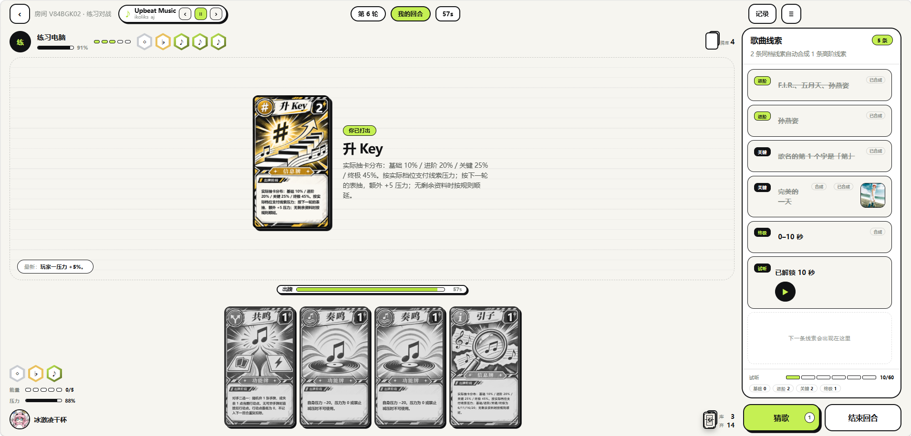
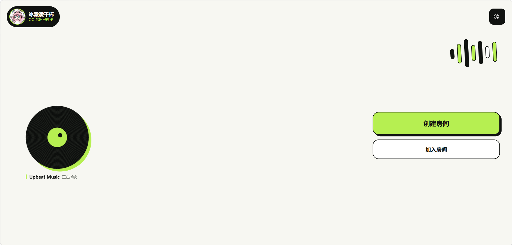
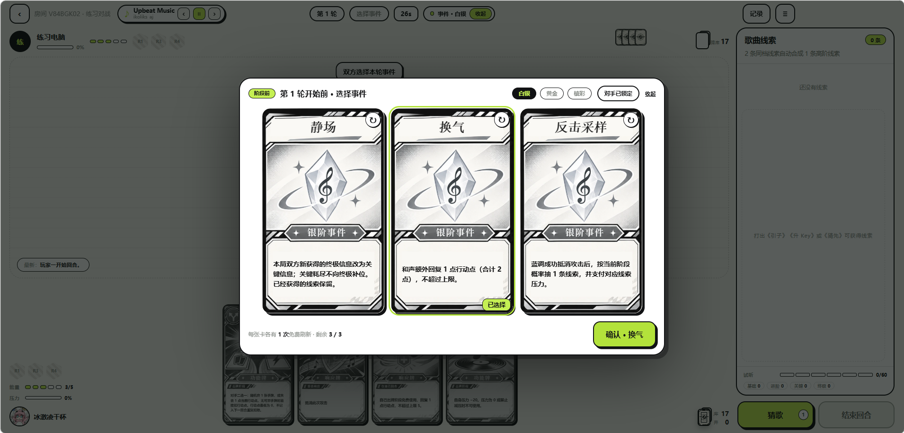
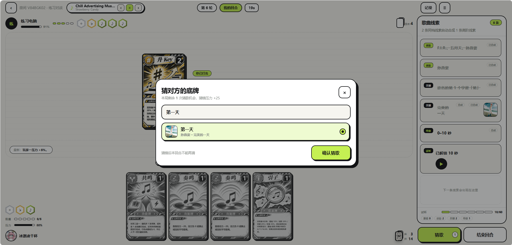
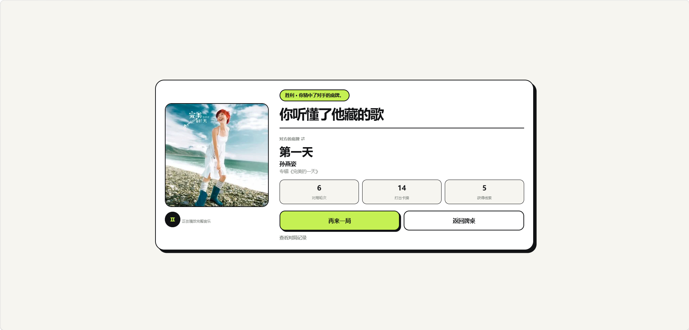

# Hidden-track

> 拜托，这么小众的歌都被你发现了，我的底牌又少了一张

**Hidden Track 是一款音乐卡牌对战游戏。** 选一首歌藏作底牌，用卡牌、事件与逐步获得的线索推测对方藏了什么，在猜歌与承受压力之间做选择。

当前版本 **1.1.1**。本地启动后使用 QQ 扫码登录 QQ 音乐，进入 **设置 → 与电脑试一局** 开始练习。

## 当前能玩什么

| 功能                 | 当前状态                                                                      |
| -------------------- | ----------------------------------------------------------------------------- |
| 人机练习             | 可用；按当前账号核验预设曲目的可播放资源                                      |
| 双人邀请对战         | 原服务器已下线，当前不可用；完整实现保留供阅读和后续维护                      |
| QQ 音乐              | 扫码登录、个人资料、搜索、曲目资料、歌词、个人音乐库与播放资源读取            |
| 个人音乐库           | 我喜欢、我的歌单、最近播放、收藏专辑、关注歌手、每日推荐                      |
| 曲目范围             | 人机候选为 9 首已有资料的 QQ 录音版本；搜索到的任意曲目不保证具备完整游戏资料 |
| 电脑网页版           | 当前推荐的游玩与展示方式                                                      |
| 手机浏览器           | 已暂时关闭网页对局，访问进入原下载引导页；此仓库不分发旧客户端安装包          |
| Android / Windows 壳 | 原生壳源码保留；历史默认地址已下线，需配置自己的可用服务并重新构建            |
| iOS                  | 尚无正式客户端                                                                |
| Vercel               | 完整游玩尚未适配，见 [部署说明](docs/DEPLOYMENT.md)                           |

### 游戏里的取舍

- 基础牌 **9 种、21 张**，事件 **38 项**；规则以 `src/shared` 与 `src/game` 为准。
- 通过卡牌拿线索，也要为信息付出压力；压力到顶会判负。
- 线索分基础、进阶、关键、终极；同档线索可以合成，受当前轮次的档位上限限制。
- 服务端统一执行行动、计时与胜负结算，并为每位玩家过滤对手的秘密信息。

玩法细节见 [玩法说明](docs/GAMEPLAY.md)。不以模拟对局结果代表真人平衡结论。

## 游戏画面

以下为项目作者提供的**电脑网页版本地人机对局实拍**，原图保留，没有重绘或改写画面中的对局状态。

<a href="docs/media/desktop-battle.png"></a>

_牌桌概览：左侧管理手牌与压力，右侧整理线索。点击任意图片可查看原始分辨率，放大阅读卡牌文字。_

<table>
  <tr>
    <td width="50%" align="center">
      <a href="docs/media/desktop-lobby.png"></a><br />
      <b>大厅</b><br />QQ 登录与背景音乐
    </td>
    <td width="50%" align="center">
      <a href="docs/media/desktop-events.png"></a><br />
      <b>事件选择</b><br />挑选本局策略
    </td>
  </tr>
  <tr>
    <td width="50%" align="center">
      <a href="docs/media/desktop-guess.png"></a><br />
      <b>猜歌</b><br />用线索锁定底牌
    </td>
    <td width="50%" align="center">
      <a href="docs/media/desktop-result.png"></a><br />
      <b>结算</b><br />揭晓对手藏的歌
    </td>
  </tr>
</table>

录屏待补充。截图来源、尺寸和采集说明见 [游戏截图与录屏](docs/media/README.md)。

## 本地运行

需要 **Node.js 24.x** 与 npm。首次运行：

```sh
npm ci
npm run check
npm start
```

打开 <http://127.0.0.1:3197/>，扫码并确认 QQ 音乐登录，然后进入设置开始电脑练习。`npm start` 在同一 Node 进程中启动游戏与已内置的 QQ 客户端模块，无需另开接口服务窗口。

`.env.example` 只包含公开示例。现有 `.env` 会通过 `scripts/start.mjs` 加载；本机版使用 `data/local-practice.sqlite`。会话加密密钥未配置时首次生成 `data/local-session.key`，重启时需保留该文件才能继续读取已保存的授权。

开发与结构见 [开发说明](docs/DEVELOPMENT.md)。网页构建成功不等于已完成公开服务器部署。

## 音乐连接与数据


登录凭证按游戏会话分别加密保存在本机数据库中。个人音乐资料仅对当前会话返回，详细行为见 [数据与隐私](PRIVACY.md)。项目不会将开发者自己的账号、设备凭证或数据库提交到仓库。

音源按当前登录账号可取得的资源读取：优先完整 MP3，缺少完整资源时可使用平台返回的试听；具体可用性取决于曲目、账号权限和上游服务。非 MP3 会返回实际格式及解码需求，当前没有实现额外的解码器。对局里的音频线索仍按规则逐段解锁。

## 参与维护

欢迎提交可复现的问题和范围清晰的改动。提交前运行 `npm run check`；修改规则时同时核对协议、秘密信息过滤、计时与存档兼容。

- [贡献指南](CONTRIBUTING.md)
- [社区行为准则](CODE_OF_CONDUCT.md)
- [安全问题报告](SECURITY.md)
- [源码结构与原双人实现](docs/ARCHITECTURE.md)

## 许可证与素材

Hidden Track 自有代码使用 [MIT License](LICENSE)。第三方代码、音乐、音效、插画、标识、曲目资料与截图中的第三方内容仍按各自权利与许可处理，**不因自有代码采用 MIT 而一并获得 MIT 授权**。

朋友提供的 QQ 接口代码随源码保留，其原分享包标注 `UNLICENSED`；具体许可信息待项目作者补充，不在这里代替原作者授予权限。完整范围见 [第三方说明](THIRD_PARTY_NOTICES.md) 与 [源码发布说明](OPEN_SOURCE_NOTES.md)。
